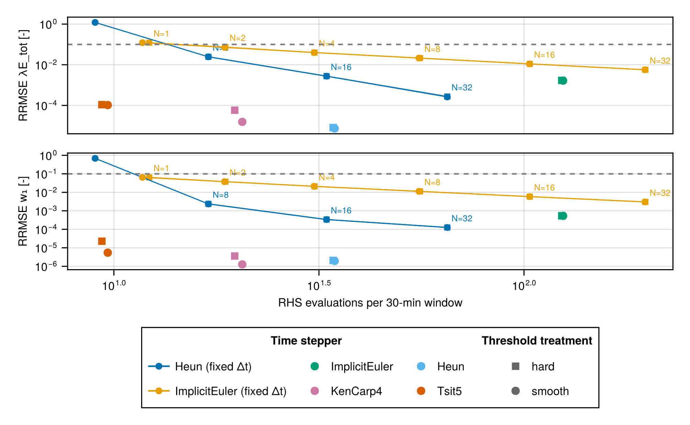
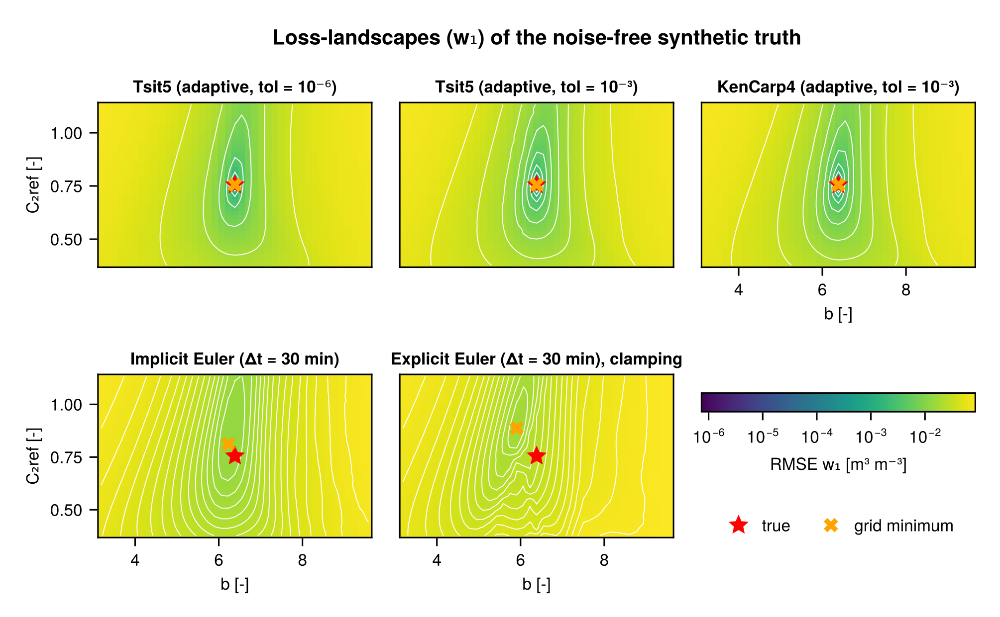
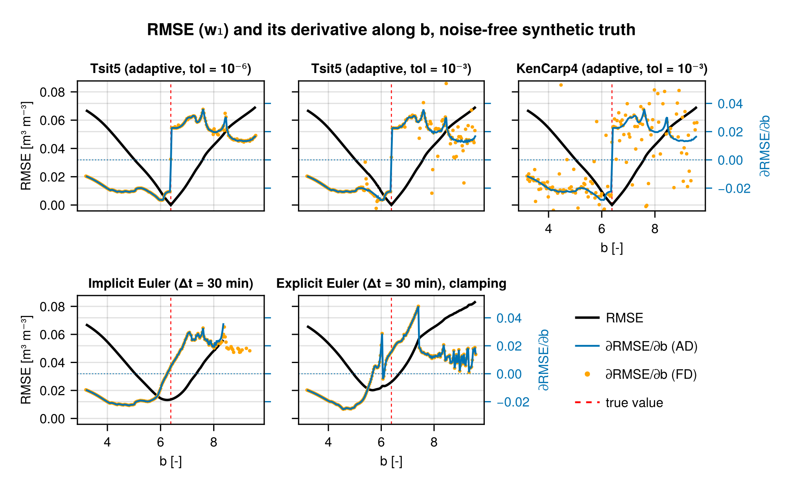
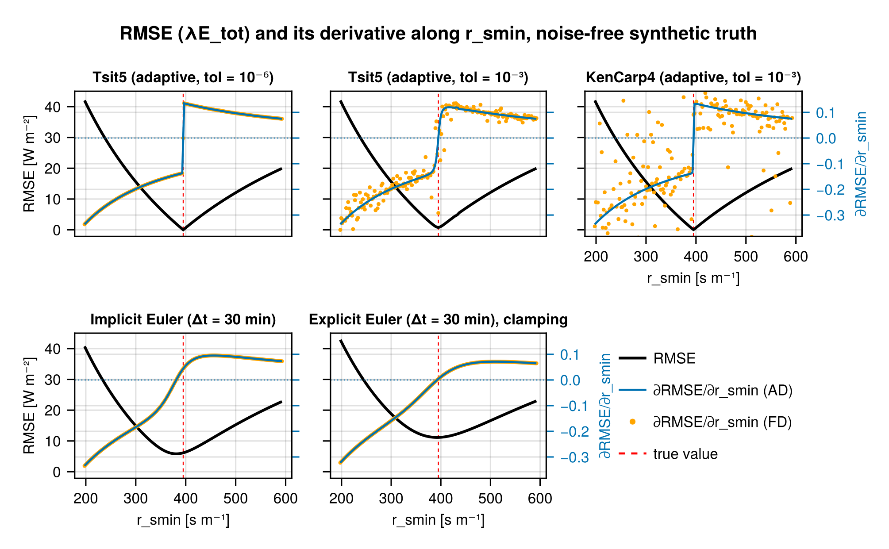

Open question on scope: potential split in 2 papers:

1. This paper:
    - model description
    - numerical choices (timestepper, smoothing)
    - Gradient fidelity: both for process-based and ML   
2. Follow-up paper:
    - Use inside on training strategies from paper 1: 1 timestepper, 1 smoothing strategy, 1 AD option.
    - Goal: showing predictive performance advantage of hybrid modelling. 
    - Use Terrarium.jl for this in any case. Advantages:
        - Well suited for running multiple sites
        - Learned results can be upscaled to global simulations
        - Discretise-then-optimise AD with Reactant.jl (own checkpoiting)/ vanilla Enzyme.jl  (use Checkpointing.jl). 

# Introduction

*Importance of modelling/understanding land surface* 

By regulating the energy, water, and biogeochemical cycles, the land surface plays a fundamental role in shaping the Earth’s climate [*Add source*]. Understanding these cycles and their corresponding feedbacks is therefore paramount, both for future climate predictions and for climate change mitigation through nature-based solutions [@bonan2024]. 

*Challenges in land surface modelling*

Many challenges lie in the use and development of models of land surface models (LSMs) however, two critical ones being managing process complexity and accurate parametrisation [@fisher2020]. Whilst some of the processes in LSMs are based on physical laws, others, especially those representing biogeochemical processes, are represented more empirically and often suffer from poorly constrained parameterisations. Given the ever-increasing amount of observational data in the geosciences, both in situ and from remote sensing, a highly promising research avenue is to use machine learning (ML) to represent processes that lack a strong theoretical basis. When these ML models are embedded within a process-based LSM, the result is a so-called hybrid model. 

*Text above comes from FWO exchange proposal, mostly a placeholder. Sources are missing in places*

To effectively calibrate these hybrid models, the differentiable modelling framework has been proposed [@shen2023]. Here, it is argued that a key part of the success of neural network-based machine learning, is its training procedure which effectively leverages gradient-based parameter optimisation methods. Therefore, the hybrid model should be constructed to allow for efficient gradient calculation to parameters.

Challenge 1 (well-established): this requires automatic differentiation techniques 

Challenge 2 (less researched): the use of gradient-based optimisation techniques requires sufficiently smooth loss landscapes. In conceptual hydrology, well established that the usual numerical implementation (operator-splitting, explicit times stepping without error control), leads to geometrically complex objective functions not amenable to gradient based optimisation [@kavetski2007; @kavetski2010; @clark2010]. Hybrid modeling requires gradient-based optimisation, but effect of numerics understudied. Previous work of @song2024 on streamflow prediction with daily input data, comparing explicit euler with direct reverse-mode AD to adjoint-based implicit euler (implicit function theorem on the Newton solves). Not explored there:

- adaptive timestepping methods
- sciml type adjoint methods vs AD on discretised code.  

*One of these uncertain processes = the effect of environmental stressors on plan transpiration (stomatal / surface resistance in LSM terminology). Idea = keep physical processes related to energy / water balances (bulk-surface formulae / potential evaporation)*

# Methods

## Model description

Keeping it fairly compact, move details to Appendix.
The novelty here = how the model needs to be adapted to behave well in an ODE framework

## Numerical implementation

*Goal = compare to advice of @clark2010, adaptive explicit (Tsit5, Heun) en implicit (Euler) vs fixed (Heun (Terrarium), Impiclit Euler)* 

ordinary differential equation (ODE) warrants choice of a solver. Importance of choice of numerical solver: 

- Simple explicit Euler scheme can have numerical errors larger than conceptual errors [@clark2010]
- Robust timestepping schemes lead to better behaved (less geometrically complex) objective functions which allow for better optimisation using gradient and hessian based optimisation methods [@kavetski2010]

Additional challenge for numerical treatment = threshold-type behaviour of a lot of environmental processes introduces discontinuities of objective function. Smoothing of of these thresholds to ensure differentiability of model [@kavetski2007]. 

Examples of codes where clamping to states is applied in combination with explicit time stepping:

- HBV model implementations in [Hy2DL](https://github.com/eduardoAcunaEspinoza/Hy2DL/blob/d328bcb973c4234d56fbce6c2ac9077f9734b27f/src/hy2dl/modelzoo/hbv.py#L124), [hydrodl2](https://github.com/mhpi/hydrodl2/blob/b163a3c0125c5188f730f379643437d83b4e5d35/src/hydrodl2/models/hbv/hbv_2_1_hourly.py#L500)
- DALEC implementation of @fang2024 (see e.g. [here](https://github.com/JianingFang/DifferLand_Global/blob/02f4668bbb191093b79546230f4e239b552b20d7/DifferLand/model/DALEC993.py#L408))

As mentioned in @huite2025, this is often combined with manually limiting fluxes to avoid overshoot ([code example](https://github.com/Huite/HydroDaemonDemo/blob/2e5a445052064b55862d97a0078dfaab2f6da71a/src/fuse/fuse.jl#L120)). 

<!-- Relevance to automatic differentation and hybrid modelling (*maybe this part is better suited for introduction*?):

- The accurate and efficient calculation of gradients underpins hybrid/differentiable modelling  -->

## Differentiation

*Gradient fidelity*. Data to test this on: 1 site (DE-Tha/BE-Bra).
Start with full process-based.

  1. Compare gradients of explicit euler with clipping those of an error controlled scheme. $\partial \lambda E / \partial \theta$. 
        - Smoothing: does this lead to more meaningful losses? 
        - Timestepper: different parameter sensitivity for different timestepper? 
  2. Synthetic truth from known parameter for Jarvis-Stewart (for a converged model with strict tolerance). Add noise, calibrate models to retrieve known parameters.
        - For badly behaving numerics, the parameters can be distorted because they try to compensate for this
  3. Same as above, but now try to learn a NN to represent Jarvis. 
  4. Real calibration of process-based model 
        - Hypothesis based on @kavetski2007 and @kavetski2010 of easiest optimisation when smoothing and stable numerics

# Results

## Numerical implementation

{#fig-rrmse-numerics width=100%}

Main conclusions from @fig-rrmse-numerics:

- The default `Tsit5` solver has low error while being computationally cheap (small amount of RHS evaluations)
- In general, adaptive time stepping schemes are more efficient: lower error per amount of RHS evaluations. Exception = adaptive implicit Euler.
- If limited to simple numerics (e.g. Terrarium.jl): use fixed-step Heun at e.g. $\Delta t/ 16$ ($\Delta t = 30$ min)

## Differentiation 

### Synthetic truth

Loss landscape compared to strict tolerances solution. *Idea: confirm the numerical time stepping artifacts in loss landscapes from Figure 1 of @kavetski2010*

{#fig-loss-landscape-b-C2ref-w1 width=100%}

Both $b$ and $C_{2,ref}$ are soil parameters, goal of being similar to @kavetski2010 where also parameters are chosen that directly affect the state. Notable observations from @fig-loss-landscape-b-C2ref-w1:

- Tolerance from $10^{-6}$ to $10^{-3}$ has for explicit adaptive `Tsit5` introduces a small amount of numerical noise (bottom left corner)
- At $10^{-3}$, the implicit adaptive solver `KenCarp4` has less numerical noise (bottom left corner smoother again)
- Implicit Euler is smooth, but to match the reference solution it's parameter has to be biased. Fixed-step implicit Euler being smoother than adaptive methods, is as in @kavetski2010. 
- Explicit Euler with state clipping has the most clearly numerically distorted loss landscape (as in @kavetski2010) with a bias in the parameter estimated. 

*Idea: as in Figure 2 of @kavetski2010, show the gradient for 1 parameter, here $b$, to show has the gradient, used in optimisation, is distorted*. 

{#fig-loss-slice-b-w1 width=100%}

Most apparent results for @fig-loss-slice-b-w1:

- For `Tsit5` (adaptive explicit), going to a less strict tolerance introduces more numerical noise in the finite-difference (FD) approximation of the gradient. This is also reported in @kavetski2010 and @kavetski2006 and has to do with the fact that a small change in parameter leads to a different number of time steps. This noise is not present in the automatic differentiation (AD) gradient, as it does not rely on this perturbation concept. 
- For `KenCarp4` (adaptive implicit), the FD gradient is even more noisy. Following the floating point analysis of @kavetski2006, it is likely that the chosen step-size (LOOK UP) is too small (i.e. floating point error dominates over truncation error) for the current setup. 
- For fixed-step implicit Euler, the FD gradient does not contain this noise. This is the reason that is is the recommended numerical method in @kavetski2006. With AD resolves the issues of micro-scale roughness of adaptive explicit schemes, it seems like this advice can be reconsidered (new finding)! Smooth gradient to biased minimum (as seen in @fig-loss-landscape-b-C2ref-w1). 
- Fixed step explicit Euler with clipping has numerical noise due to its timestepping algorithm, present in both FD and AD gradients. The switch from positive to negative gradient and back around $b \gtrsim 6$ could be problematic for a gradient-based optimisation. 

{#fig-loss-slice-rsmin-lambdaE-tot width=100%}

Note that this sensitivity of the $\frac{\partial RMSE}{\partial b}$ for $w_1$ to the timestepping algorithm is due to its rapidly changing, numerically stiff behaviour. If once performs a similar analysis for $\lambda E$, which is time-averaged over the 30 min-interval, all timestepping methods produce more similar loss landscapes and gradients. $\lambda E$, dominated by $\lambda E_t$, is more sensitive to $w_2$ than to $w_1$ via $r_s$, which changes more slowly in time (less numerically stiff). This is visualised in @fig-loss-slice-rsmin-lambdaE-tot, where the sensitivity of the RMSE to $r_{s,min}$ is shown. Fixed-step implicit and explicit euler show smooth gradients, contrasting the noisy gradients for explicit euler in the case of $w_1$.

# Discussion

# Conclusion



# Appendix {.unnumbered}

# References {.unnumbered}

::: {#refs}
:::